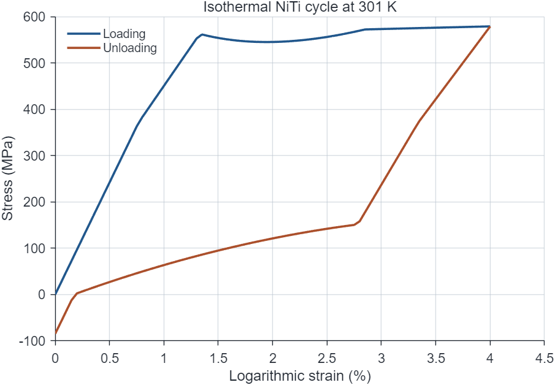

# Hot Ratchets

Hot Ratchets is a MATLAB research codebase for thermomechanical simulation of shape-memory alloys in thermal ratchets and elastocaloric cycles. It provides constitutive updates for NiTi and Cu–Al–Mn, along with elastic martensite-band calculations based on the cylindrical inclusion model of Sun and Zhong.

## Quick start

The examples and numerical checks have been tested with MATLAB R2025b. The optional source-level NiTi joint solver uses Optimization Toolbox.

```sh
git clone --depth 1 https://github.com/piAlbertSHI/Hot-Ratchets.git
cd Hot-Ratchets
matlab -batch "addpath('examples'); demo_niti_cycle"
```

The constitutive package can also be called directly from MATLAB.

```matlab
addpath('matlab');
p = sma.params('niti_zhang2022');
state = sma.initial_state_1d(p);
[trial, info] = sma.update_1d_stress(p, state, 200, state.T, 0.1, false);
state = trial;
```

`sma.update_1d_stress` takes stress in MPa, temperature in K, and step duration in seconds. For strain control, use `sma.update_1d_strain` with logarithmic strain. Use `sma.coupled_step_1d` to advance temperature along with the material state.

## Examples

| Example | Output |
| --- | --- |
| `demo_niti_cycle` | Isothermal NiTi cycle driven to 4% logarithmic strain and back to zero strain. Saves a CSV and stress–strain plot under `outputs/`. |
| `demo_cualmn_ramp` | Four coupled material steps for annealed Cu–Al–Mn under a prescribed engineering strain rate. |
| `demo_sun_band` | Elastic inclusion shape factors and band-length energy gradients for four aspect ratios. |



*Simulation from `demo_niti_cycle` with prescribed strain at 301 K.*

```sh
matlab -batch "addpath('examples'); demo_cualmn_ramp; demo_sun_band"
matlab -batch "addpath('tests'); run_tests"
```

The examples use prescribed simulation inputs. The tests check control residuals, restart state, phase accounting, thermal balance, and the elastic band kernels.

## Repository layout

- [`matlab/+sma`](matlab/+sma) contains material cards, constitutive updates, and research kernels.
- [`examples`](examples) contains small simulations with inputs defined in code.
- [`tests`](tests) contains numerical contract checks for the public package.
- [`docs`](docs/model-notes.md) describes the model, units, and sources.

## Development status

The repository provides a material-level solver and numerical checks. Recent NiTi research has resolved the first exhaustion of ordinary martensite during unloading and checked the first step with ordinary and stable martensite present in different regions. Full-cycle validation, including zero-load recovery and coupling to band motion, is ongoing. See [model notes](docs/model-notes.md) and [contribution guidelines](CONTRIBUTING.md).

## License

A project license has yet to be selected.
